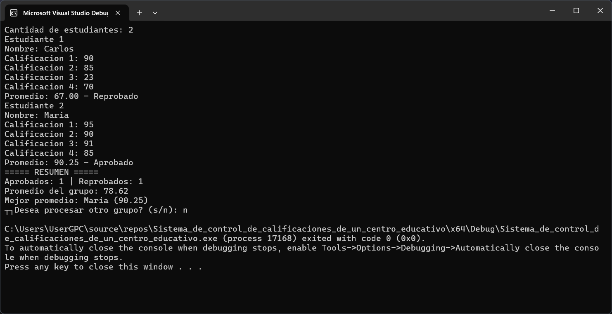
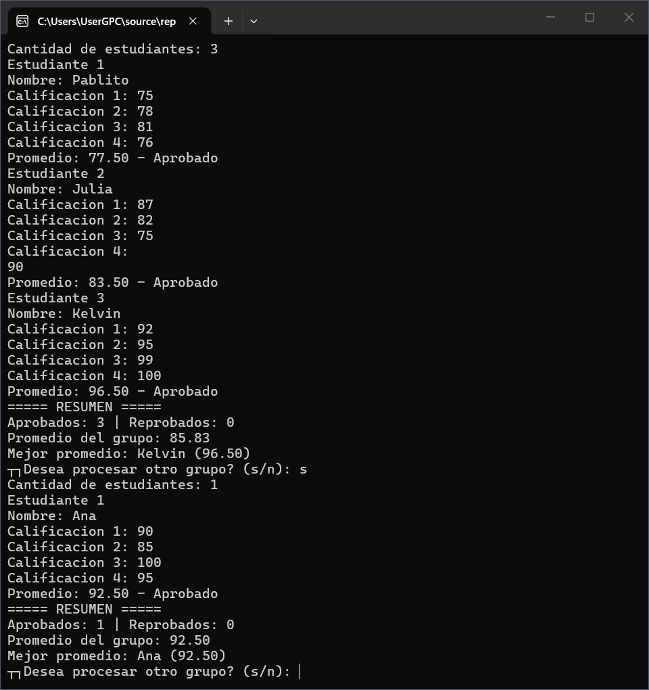
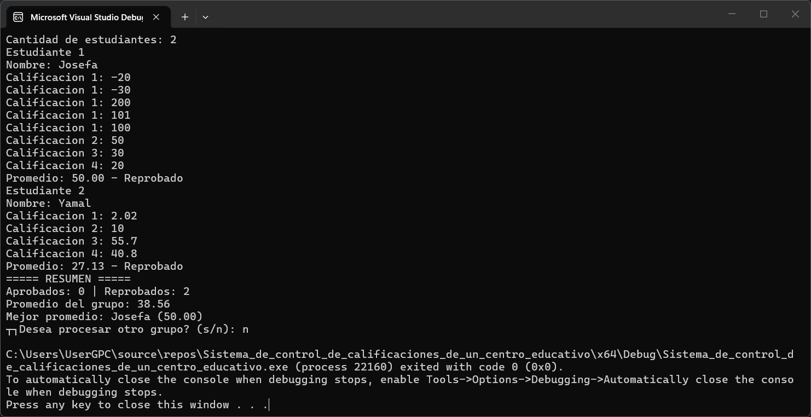

# Sistema de control de calificaciones de un centro educativo
Programa de consola para registrar calificaciones de estudiantes mediante bucles, validando los datos, calculando promedios y generando un resumen final del grupo.

## Datos del estudiante
- **Nombre:** Kelvin Alberto Santana Beltre.
- **Matrícula:** *[2025-2485]*.

## Descripción breve del programa
Una aplicación de consola diseñada para registrar las notas de un grupo de estudiantes. El sistema se encarga de solicitar los datos, validar que no se ingresen valores fuera de rango, calcular el promedio individual indicando si aprueban o reprueban, y emitir un resumen del grupo completo al finalizar el registro.

## Lógica del programa
- **Datos de entrada:** Cantidad de estudiantes (valor entero), el nombre de cada estudiante (texto), 4 calificaciones por estudiante (valores decimales) y una letra (s/n) para repetir el programa.
- **Datos que procesa:** 
  - Validación continua para rechazar estudiantes en negativo/cero y calificaciones fuera del rango 0-100.
  - Cálculo del promedio individual (suma de 4 notas dividida entre 4).
  - Condición para determinar el estado: Aprobado (>= 70) o Reprobado (< 70).
  - Acumulación y comparaciones para determinar el total de aprobados, reprobados, el promedio general y el estudiante con la nota más alta.
- **Datos de Salida:** Impresión en pantalla del promedio individual con su estado correspondiente, seguido de un reporte final que incluye contadores generales y el mejor promedio del aula.

## Captura de pantalla del programa en ejecución
### Ejemplo No.1 (Flujo normal del programa)

### Ejemplo No.2 (Repetición del ciclo completo)

### Ejemplo No.3 (Validación de datos erróneos)

## Estructura utilizada y su función
Para este desarrollo utilicé **bucles anidados** y **condicionales múltiples**, dividiendo el flujo del programa en cajas lógicas de repetición, respetando la consigna de no usar arreglos ni funciones externas:
- **Bucle principal (`do-while`):** Lo utilicé como contenedor principal de todo el algoritmo. Su función es asegurar que el programa se ejecute al menos una vez y evaluar al final si el usuario desea reiniciar el proceso completo para un nuevo grupo.
- **Bucles de recorrido y validación (`while`):** Los implementé con un doble propósito: iterar sobre cada estudiante y sus 4 calificaciones exactas, y actuar como un filtro de validación que atrapa al usuario repitiendo la pregunta si ingresa datos ilógicos (como notas de 120 o negativas).
- **Estructura condicional (`if/else`):** La utilicé para evaluar el cálculo de los promedios, bifurcando el camino para contar a los aprobados o reprobados, y para ir guardando condicionalmente el nombre y la nota del estudiante que va obteniendo el mejor rendimiento.
